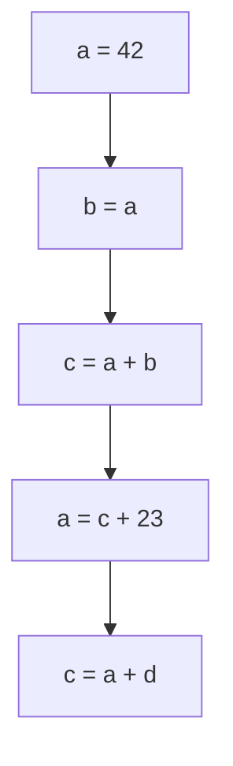
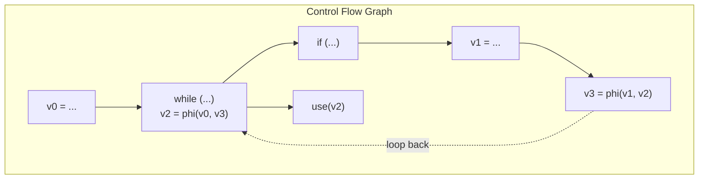

# Simple and Efficient Construction of Static Single Assignment Form

# 静态单赋值形式的简单高效构建

We present a simple SSA construction algorithm, which allows direct translation from an abstract syntax tree or bytecode into an SSA-based intermediate representation.

我们提出了一种简单的静态单赋值构建算法, 该算法允许直接将抽象语法树或字节码翻译为基于静态单赋值的中间表示.

> **编译器理论背景：**
> 传统的编译器在前端解析语法时, 通常会将局部变量全部存入内存栈, 然后再通过复杂的算法将这些内存访问转换为静态单赋值形式. 而 Braun 算法的核心优势在于：它在从抽象语法树生成中间表示的那一刻起, 就直接按静态单赋值规范落盘, 从而彻底消除了对内存槽的依赖.

---

## 1. Introduction

## 1. 绪论

Many modern compilers feature intermediate representations based on the static single assignment form.

许多现代编译器都采用基于静态单赋值形式的中间表示.

SSA was conceived to make program analyses more efficient by compactly representing **use-def chains**.

设计静态单赋值的初衷是通过紧凑地表示 **定义-使用链** 来提升程序分析的效率.

Over the last years, it turned out that the SSA form not only helps to make analyses more efficient but also easier to implement, test, and debug.

在过去的几年里, 人们发现静态单赋值形式不仅能提高分析效率, 还能让编译器的实现、测试和调试变得更容易.

Thus, modern compilers exclusively base their intermediate representation on the SSA form.

因此, 现代编译器无一例外地将它们的中间表示建立在静态单赋值形式之上.

> **编译器理论背景：**
> **定义-使用链** 记录了一个变量在何处被定义, 以及它的值在哪些地方被使用. 在非静态单赋值代码中, 由于同一个变量可以被多次赋值, 追踪一个值需要遍历复杂的控制流. 而静态单赋值保证每个变量只被赋值一次, 这使得 **定义-使用链** 变成了一个直接的静态指向关系, 极大简化了后续的数据流优化.

The first algorithm to efficiently construct the SSA form was introduced by Cytron et al..

高效构造静态单赋值形式的第一个算法由 Cytron 等人提出.

One reason, why this algorithm still is very popular, is that it guarantees a form of minimality on the number of placed $\phi$ functions.

该算法至今仍然非常流行的一个原因, 是它保证了所放置的 $\phi$ 函数数量的极小性.

However, for compilers that are entirely SSA-based, this algorithm has a significant drawback: Its input program has to be represented as a control flow graph in non-SSA form.

然而, 对于完全基于静态单赋值的编译器来说, 该算法有一个显著的缺陷：其输入程序必须表示为非静态单赋值形式的控制流图.

Hence, if the compiler wants to construct SSA from the input language, it has to take a detour through a non-SSA CFG in order to apply Cytron et al.'s algorithm.

因此, 如果编译器想要从输入语言构建静态单赋值, 就必须先绕道构建一个非静态单赋值的控制流图, 才能应用 Cytron 等人的算法.

Furthermore, to guarantee the minimality of the function placement, Cytron et al.'s algorithm relies on several other analyses and transformations.

此外, 为了保证 $\phi$ 函数放置的极小性, 该算法依赖于其他几项分析与变换.

To calculate the locations where $\phi$ functions have to be placed, it computes a dominance tree and the iterated dominance frontiers.

为了计算必须放置 $\phi$ 函数的位置, 它需要计算支配树和迭代支配边界.

To avoid placing dead functions, liveness analyses or dead code elimination has to be performed.

为了避免放置死函数, 还必须执行活跃性分析或死代码消除.

Both, requiring a CFG and relying on other analyses, make it inconvenient to use this algorithm in an SSA-centric compiler.

既需要控制流图又依赖其他分析, 这使得在一个以静态单赋值为中心的编译器中使用该算法变得非常不便.

> **编译器理论背景：**
> 支配树描述了控制流中节点之间的必然先后关系：如果从入口到节点 B 的所有路径都必须经过节点 A, 则称 A 支配 B. 迭代支配边界则是放置 $\phi$ 节点的理论几何依据. Cytron 算法必须依赖这些重量级的图论分析, 才能决定在哪些汇聚点插入 $\phi$.

---

## 2. Simple SSA Construction

## 2. 简单的静态单赋值构造

In the following, we describe our algorithm to construct SSA form. It significantly differs from Cytron et al.'s algorithm in its basic idea. Cytron et al.'s algorithm is an eager approach operating in forwards direction.

接下来, 我们将介绍我们构造静态单赋值形式的算法. 它的基本思想与 Cytron 等人的算法有着显著的不同. Cytron 等人的算法是一种采用前向流向的急切方法.

First, the algorithm collects all definitions of a variable.

首先, 该算法收集变量的所有定义.

Then, it calculates the placement of corresponding $\phi$ functions and, finally, pushes these definitions down to the uses of the variable.

接着, 它计算相应 $\phi$ 函数的放置位置, 最后将这些定义向下推送到变量的使用点.

In contrast, our algorithm works backwards in a lazy fashion.

与此相反, 我们的算法以一种按需的惰性方式反向工作.

Only when a variable is used, we query its reaching definition.

只有当某个变量被使用时, 我们才查询它的到达定义.

If it is unknown at the current location, we will search backwards through the program.

如果在当前位置未知, 我们就会在程序中向后搜索.

We insert $\phi$ functions at join points in the CFG along the way, until we find the desired definition.

我们在沿途的控制流图汇聚点插入 $\phi$ 函数, 直到找到所需的定义.

We employ memoization to avoid repeated look-ups.

我们采用记忆化来避免重复查找.

> **编译器理论背景：**
> 这种按需查询的逆向搜索策略是 Braun 算法的核心精髓. 它彻底打破了传统编译器必须先全局收集所有定义、再计算支配边界的传统范式, 将构建过程与变量的实际消费动作绑定在一起.

### 2.1 Local Value Numbering

### 2.1 局部值编号

When translating a source program, the IR for a sequence of statements usually ends up in a single basic block.

在翻译源程序时, 一系列语句的中间表示通常会落入一个单一的基本块中.

We process these statements in program execution order and for each basic block we keep a mapping from each source variable to its current defining expression.

我们按照程序执行顺序处理这些语句, 并为每个基本块维护一个从源变量到其当前定义表达式的映射.

When encountering an assignment to a variable, we record the IR of the right-hand side of the assignment as current definition of the variable.

当遇到对变量的赋值时, 我们将赋值右侧的中间表示记录为该变量的当前定义.

Accordingly, when a variable is read, we look up its current definition.

相应地, 当读取变量时, 我们查找其当前定义.

This process is well known in literature as local value numbering.

在文献中, 这个过程被称为局部值编号.

When local value numbering for one block is finished, we call this block filled.

当一个块的局部值编号完成后, 我们称该块为已填充的.

Particularly, successors may only be added to a filled block.

特别地, 后继块只能被添加到已填充的块中.

This property will later be used when handling incomplete CFGs.

这一属性稍后将在处理不完整控制流图时被用到.



```csharp
Value readVariable(Variable variable, BasicBlock block) {
    if (currentDef[variable].ContainsKey(block)) {
        // local value numbering
        return currentDef[variable][block];
    }
    // global value numbering
    return readVariableRecursive(variable, block);
}

void writeVariable(Variable variable, BasicBlock block, Value value) {
    currentDef[variable][block] = value;
}

```

> **编译器理论背景：**
> 局部值编号是在单个基本块内部消除冗余计算并追踪变量最新版本的标准技术. 当块内发生多次对同一变量的赋值时, currentDef 映射会被不断更新, 从而自然地维护了块内部的定值历史.

### 2.2 Global Value Numbering

### 2.2 全局值编号

If a block currently contains no definition for a variable, we recursively look for a definition in its predecessors.

如果一个块当前不包含某个变量的定义, 我们就会在其前驱中递归地查找定义.

If the block has a single predecessor, just query it recursively for a definition.

如果该块只有一个前驱, 只需递归查询该前驱的定义即可.

Otherwise, we collect the definitions from all predecessors and construct a $\phi$ function, which joins them into a single new value.

否则, 我们收集所有前驱的定义, 并构造一个 $\phi$ 函数, 将它们合并为一个单一的新值.

This function is recorded as current definition in this basic block.

该 $\phi$ 函数被记录为该基本块中的当前定义.



Looking for a value in a predecessor might in turn lead to further recursive look-ups.

在前驱中查找值可能会进而导致进一步的递归查找.

Due to loops in the program, those might lead to endless recursion.

由于程序中存在循环, 这些查找可能会导致无限递归.

Therefore, before recursing, we first create the $\phi$ function without operands and record it as the current definition for the variable in the block.

因此, 在递归之前, 我们首先创建没有操作数的 $\phi$ 函数, 并将其记录为该块中该变量的当前定义.

Then, we determine the function's operands.

然后, 我们确定该 $\phi$ 函数的操作数.

If a recursive look-up arrives back at the block, this $\phi$ function will provide a definition and the recursion will end.

如果递归查找重新回到了该块, 这个 $\phi$ 函数将提供一个定义, 从而终止递归.

Algorithm 2 shows pseudocode to perform global value numbering.

算法 2 展示了执行全局值编号的伪代码.

Its first condition will be used to handle incomplete CFGs, so for now assume it is always false.

它的第一个条件将用于处理不完整的控制流图, 因此目前假设它始终为假.

> **编译器理论背景：**
> 针对循环引起的无限递归, Braun 算法采用了一种精妙的占位优先策略：先创建一个空操作数的 $\phi$ 节点并挂载到当前块, 再向四周前驱递归索要值. 当递归路径因为循环回边再次撞到这个块时, 这个尚未填满的 $\phi$ 就会直接被当成已知定义返回, 从而完美切断死循环.

```csharp
Value readVariableRecursive(Variable variable, BasicBlock block) {
    Value val;
    if (!sealedBlocks.Contains(block)) {
        // Incomplete CFG
        val = new Phi(block);
        incompletePhis[block][variable] = val;
    } else if (block.Preds.Count == 1) {
        // Optimize the common case of one predecessor: No phi needed
        val = readVariable(variable, block.Preds[0]);
    } else {
        // Break potential cycles with operandless phi
        val = new Phi(block);
        writeVariable(variable, block, val);
        addPhiOperands(variable, (Phi)val);
    }
    writeVariable(variable, block, val);
    return val;
}

Value addPhiOperands(Variable variable, Phi phi) {
    // Determine operands from predecessors
    foreach (var pred in phi.Block.Preds) {
        phi.AppendOperand(readVariable(variable, pred));
    }
    return tryRemoveTrivialPhi(phi);
}

```

```csharp
Value tryRemoveTrivialPhi(Phi phi) {
    Value same = null;
    foreach (var op in phi.Operands) {
        if (op == same || op == phi) {
            continue; // Unique value or self-reference
        }
        if (same != null) {
            return phi; // The phi merges at least two values: not trivial
        }
        same = op;
    }
    if (same == null) {
        same = new Undef(); // The phi is unreachable or in the start block
    }

    var users = new List<Value>(phi.Users);
    phi.Users.Remove(phi); // Remember all users except the phi itself
    phi.ReplaceBy(same); // Reroute all uses of phi to same and remove phi

    foreach (var use in users) {
        if (use is Phi phiUse) {
            tryRemoveTrivialPhi(phiUse);
        }
    }
    return same;
}

```

Recursive look-up might leave redundant $\phi$ functions.

递归查找可能会留下冗余的 $\phi$ 函数.

We call a $\phi$ function trivial iff it just references itself and one other value $v$ any number of times.

当且仅当一个 $\phi$ 函数仅引用其自身以及另一个任意次数的值时, 我们称该 $\phi$ 函数为平凡的.

Such a function can be removed and the value $v$ is used instead (see Algorithm 3).

这样的函数可以被移除, 并直接使用对应的值代替（见算法 3）.

As a special case, the $\phi$ function might use no other value besides itself.

作为一种特殊情况, 如果 $\phi$ 函数除了自身之外不使用任何其他值.

This means that it is either unreachable or in the start block.

这意味着它要么是不可到达的, 要么位于起始块中.

We replace it by an undefined value.

此时我们将其替换为一个未定义的值.

> **编译器理论背景：**
> 工业级静态单赋值构建最怕产生大量无意义的无用 $\phi$ 节点. tryRemoveTrivialPhi 会在每次创建 $\phi$ 后立即进行代数化简, 如果发现该 $\phi$ 实际上没有合流任何不同的值, 就将其原地拔除, 并将所有下游引用直接重定向到那个唯一合法的源头值上.

### 2.3 Handling Incomplete CFGs

### 2.3 处理不完整的控制流图

We call a basic block sealed if no further predecessors will be added to the block.

如果不会再向某个基本块添加其他前驱, 我们称该基本块为封闭的.

As only filled blocks may have successors, predecessors are always filled.

由于只有已填充的块才能拥有后继, 因此前驱必定是已经填充的.

Note that a sealed block is not necessarily filled.

需要注意的是, 已封闭的块不一定已经填充满.

Intuitively, a filled block contains all its instructions and can provide variable definitions for its successors.

直观地说, 一个已填充的块包含其所有的指令, 并能为其后继提供变量定义.

Conversely, a sealed block may look up variable definitions in its predecessors as all predecessors are known.

相反, 一个已封闭的块可以在其前驱中查找变量定义, 因为所有前驱都是已知的.

```csharp
void sealBlock(BasicBlock block) {
    foreach (var kvp in incompletePhis[block]) {
        addPhiOperands(kvp.Key, (Phi)kvp.Value);
    }
    sealedBlocks.Add(block);
}

```

But how to handle a look-up of a variable in an unsealed block, which has no current definition for this variable?

但是在某个未封闭的块中查找一个当前没有定义的变量时, 该如何处理？

In this case, we place an operandless $\phi$ function into the block and record it as proxy definition (see first case in Algorithm 2).

在这种情况下, 我们在该块中放置一个无操作数的 $\phi$ 函数, 并将其记录为代理定义（见算法 2 的第一种情况）.

Further, we maintain a set of these proxies per block.

此外, 我们为每个块维护一个代理集合.

When later on a block gets sealed, we add operands to these functions (see Algorithm 4).

当稍后块被封闭时, 我们向这些函数添加操作数（见算法 4）.

Again, when the function is complete, we check whether it is trivial.

同样, 当函数完整时, 我们会检查它是否为平凡的.

> **编译器理论背景：**
> 在从抽象语法树翻译成控制流图的过程中, 循环体内部的跳转回边对应的后继块往往在解析到一半时尚未建立完整. 此时的块被称为未封闭的. 通过引入暂存代理 $\phi$, 算法允许在控制流图尚未完全成型时先行向前推进, 待后续调用封闭块函数时再补票回填前驱操作数.

---

## 3. Optimizations

## 3. 优化

### 3.1 On-the-Fly Optimizations

### 3.1 运行时即时优化

In the previous section, we showed that we optimize trivial $\phi$ functions as soon as they are created.

我们在上一节中展示了我们在平凡 $\phi$ 函数一被创建时就对其进行优化.

Since $\phi$ functions belong to the IR, this means we employ an IR optimization during SSA construction.

由于 $\phi$ 函数属于中间表示, 这意味着我们在静态单赋值构造过程中就采用了中间表示优化.

Obviously, this is not possible with all optimizations.

显然, 并非所有优化都能以这种方式进行.

In this section, we elaborate what kind of IR optimizations can be performed during SSA construction and investigate their effectiveness.

在本节中, 我们将详细阐述在静态单赋值构造过程中可以执行哪些类型的中间表示优化, 并探究它们的有效性.

- **Arithmetic Simplification**: All IR node constructors perform peephole optimizations and return simplified nodes when possible.

**算术简化**：所有中间表示节点构造函数都执行窥孔优化, 并在可能时返回简化后的节点.

- _术语解释——窥孔优化_：窥孔优化是一种局部代码优化技术. 编译器会检查指令流中一个极小的滑动窗口, 如果发现其中包含诸如连续的加载和存储或者冗余的算术运算, 就会直接将其替换为更高效的单条指令或等效代码.

- **Common Subexpression Elimination**: This optimization reuses existing values that are identified by local value numbering.

**公共子表达式消除**：该优化重用由局部值编号识别出的现有值.

- **Constant Folding**: This optimization evaluates constant expressions at compile time.

**常量折叠**：该优化在编译时对常量表达式进行求值.

- **Copy Propagation**: This optimization removes unnecessary assignments to local variables. In SSA form, there is no need for such assignments, we can directly use the value of the right-hand side.

**复写传播**：该优化移除了对局部变量的不必要赋值. 在静态单赋值形式中, 无需此类赋值, 我们可以直接使用右侧的值.

> **编译器理论背景：**
> 传统编译流水线通常是阶段割裂的：先建出冗余的原始中间表示, 再跑一堆独立的优化 Pass. 而 Braun 算法最惊艳的地方在于它支持边建边优. 由于节点在被实例化的瞬间就会触发本地化简与常量折叠, 许多在非静态单赋值阶段看似必须存在的控制流和临时变量, 在出生瞬间就被直接掐断, 从而大幅压减了最终生成的中间表示规模.

### 3.2 Minimal SSA Form for Arbitrary Control Flow

### 3.2 针对任意控制流的极小静态单赋值形式

So far, our SSA construction algorithm does not construct minimal SSA form in the case of irreducible control flow.

到目前为止, 在存在不可约控制流的情况下, 我们的静态单赋值构造算法无法构建出极小静态单赋值形式.

Figure 5b shows the constructed SSA form for the program shown in Figure 5a.

图 5b 展示了图 5a 所示程序所构造的静态单赋值形式.

Figure 5c shows the corresponding minimal SSA form as constructed by Cytron et al.'s algorithm.

图 5c 展示了由 Cytron 等人的算法所构造的相应极小静态单赋值形式.

Since there is only one definition for the variable x, the $\phi$ functions constructed by our algorithm are superfluous.

由于变量只有一个定义, 我们算法所构造的 $\phi$ 函数是多余的.

> **编译器理论背景：**
> 不可约控制流通常由非结构化的跳转语句引起. 在具有此类结构的控制流中, 由于经典的支配树性质遭到破坏, 纯局部回溯的 Braun 算法可能会多生成一些死 $\phi$ 节点. 为此, 论文在构建完成后引入了一个专门的后置扫描阶段来进行强连通分量清理.

---

## 4. Properties of Our Algorithm

## 4. 本算法的性质

- **Pruned SSA Form**: A program is said to be in pruned SSA form if each $\phi$ function has at least one non-$\phi$ user. We only create $\phi$ functions on demand when a user asks for it. So our construction naturally produces a program in pruned SSA form.

**精简静态单赋值形式**：如果每个 $\phi$ 函数都至少有一个非 $\phi$ 用户, 则称程序处于精简静态单赋值形式. 我们仅在用户按需请求时才创建 $\phi$ 函数, 因此我们的构建过程自然而然地会产生处于精简静态单赋值形式的程序.

- **Minimal SSA Form**: Minimal SSA form requires that functions for a variable only occur in basic blocks where different definitions of that variable meet for the first time.

**极小静态单赋值形式**：极小静态单赋值形式要求变量的 $\phi$ 函数仅出现在该变量的不同定义首次相遇的基本块中.

---

## 5. Other Applications of the Algorithm

## 5. 算法的其他应用

### 5.1 SSA Reconstruction

### 5.1 静态单赋值重构

Some transformations like live range splitting, rematerialization or jump threading introduce additional definitions for an SSA value.

某些变换（如活跃区间分裂、复活或跳转线索化）会为一个静态单赋值值引入额外的定义.

Because this violates the SSA property, SSA has to be reconstructed.

由于这违反了静态单赋值属性, 因此必须对静态单赋值进行重构.

> **编译器理论背景：**
> 传统的静态单赋值构造算法无法直接用于后端优化中的静态单赋值重构, 因为后端优化常常是局部地塞入一个新定值, 而传统算法要求全盘重新跑支配边界分析. 而 Braun 算法本质上是一个局部且按需的查询引擎, 只需把新定值注册到对应块中, 后续的读取自然会通过逆向搜索把缺失的 $\phi$ 补上, 这使得它极其适合用作后端优化的重构工具.

---

## 6. Evaluation

## 6. 评估

In total, SSA construction reduces the number of instructions by 25%, which demonstrates the significant overhead of the temporary non-SSA IR.

总体而言, 静态单赋值构造将指令数量减少了 25%, 这证明了临时非静态单赋值中间表示具有相当大的开销.

Comparing the number of constructed instructions, we see small differences between the results of LLVM's and our SSA-construction algorithm.

比较构建出的指令数量, 我们发现算法的实际运行结果与传统算法高度吻合.

---

## 7. Related Work

## 7. 相关工作

SSA form was invented by Rosen, Wegman, and Zadeck and became popular after Cytron et al. presented an efficient algorithm for constructing it.

静态单赋值形式由相关学者发明, 并在高效算法提出后开始流行.

This algorithm can be found in all textbooks presenting SSA form and is used by the majority of compilers.

该算法可以在所有介绍静态单赋值形式的教科书中找到, 并被大多数现代编译器所采用.

---

## 8. Conclusions

## 8. 结论

In this paper, we presented a novel, simple, and efficient algorithm for SSA construction.

在本文中, 我们提出了一种新颖、简单且高效的静态单赋值构造算法.

In comparison to existing algorithms it has several advantages: It does not require other analyses and transformations to produce minimal and pruned SSA form.

与现有算法相比, 它具有几个优势：它不需要其他分析和变换就能产生极小且精简的静态单赋值形式.

It can be directly constructed from the source language without passing through a non-SSA CFG.

可以直接从源语言构建而无需经过非静态单赋值的控制流图.

It is well suited to perform several standard optimizations already during SSA construction.

并且非常适合在构造过程中就已经执行几项标准优化.
